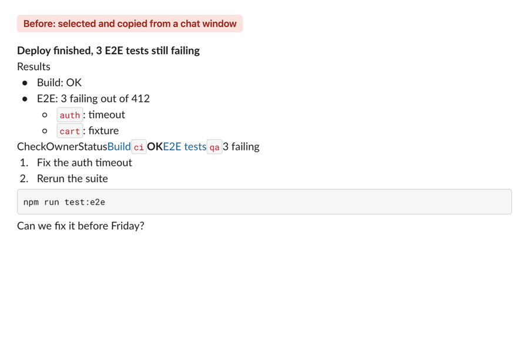
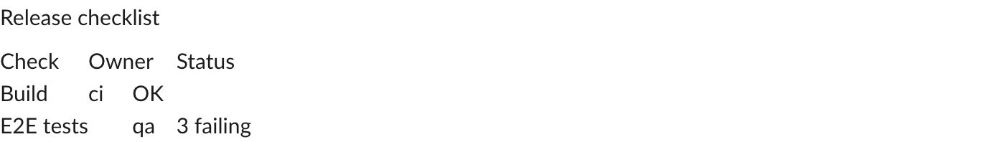
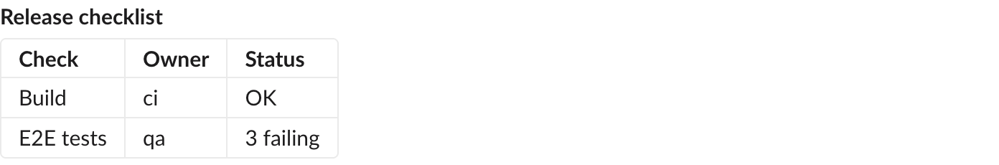
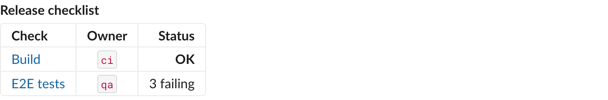
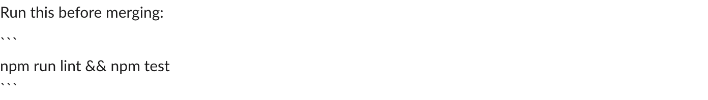
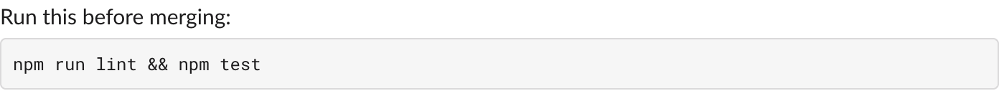

# slack-paste

Write a Slack message in markdown, copy it, press Cmd+V in Slack, and get real headings, lists,
links, code blocks and tables. This repo holds two things:

- **`to-slack`**, an agent skill (Claude Code, Codex, Cursor and other Agent Skills clients) with
  its script: it drafts the message, shows it to you, then puts it on the macOS clipboard in the
  form Slack's composer formats best.
- **[FINDINGS.md](FINDINGS.md)**, how Slack's composer turns a paste into a message, tested in a
  throwaway workspace with the Playwright lab in [`lab/`](lab/): which clipboard type wins, the
  regex that decides whether text is markdown, what each markdown and HTML construct becomes, and
  the `slack/block-kit` clipboard type that gives tables with formatted cells.



The same agent reply, pasted into Slack twice. Before: selected in the chat window and copied with
Cmd+C. After: copied with `to-slack`.

## How you copy decides what Slack shows

| How you copy | What lands on the clipboard | What Slack loses |
|---|---|---|
| Select the rendered reply (VS Code, ChatGPT, Claude) and press Cmd+C | HTML + plain text with the markdown already stripped | headings become plain lines; a table collapses into one line of text or into tab-separated text; code blocks lose their language |
| The reply's copy button, or the raw markdown | markdown as plain text | table cells lose bold, code, links and alignment; `_italic_` at the very start and a fence without a language stay literal when nothing else in the text looks like markdown |
| `to-slack` | markdown + HTML, and Block Kit with `--blocks` | nothing in these tests |

Why: Slack runs its markdown converter only when the plain text looks like markdown, falls back to
its HTML importer otherwise, and that importer drops headings and ignores HTML tables.
[FINDINGS.md](FINDINGS.md) has the full rules.

A table, three ways (rendered copy, raw markdown, `to-slack --blocks`):





Raw markdown that Slack does not recognize (left), the same text through `to-slack` (right):

 

 

## Modes

| Mode | Clipboard | Use it for |
|---|---|---|
| `--rich` | markdown as plain text + HTML (pandoc) | everyday messages |
| `--blocks` | the above + Slack Block Kit JSON | tables with bold, code, links or alignment |
| `--code-tables` | tables as an aligned code block | workspaces without table support |
| no flag / `--copy` | Slack mrkdwn | bots, webhooks, `chat.postMessage` |

## Install

macOS only (the clipboard is written through `osascript`). Needs `pandoc`
(`brew install pandoc`); `--blocks` also needs `markdown-it-py` or `uv`.

Any Agent Skills client:

```bash
npx skills add PierreBastiani/slack-paste
```

Claude Code plugin:

```
/plugin marketplace add PierreBastiani/slack-paste
/plugin install to-slack@slack-paste
```

Codex plugin (then install `to-slack` from the plugin list):

```bash
codex plugin marketplace add PierreBastiani/slack-paste
```

Or copy `plugins/to-slack/skills/to-slack/` into `~/.claude/skills/`.

The script also works without an agent:

```bash
plugins/to-slack/skills/to-slack/scripts/md-to-slack.sh --rich < message.md
```

## Pair it with a writing skill

`to-slack` handles format: what Slack's composer accepts and what reads well in a narrow chat
column. It says nothing about the wording. For that, install
[no-ai-slop](https://github.com/petergyang/no-ai-slop) by Peter Yang, which edits a draft into
plainer, more direct writing and keeps your voice:

```bash
npx skills add https://github.com/petergyang/no-ai-slop --skill no-ai-slop
```

With both installed, ask the agent to run the draft through no-ai-slop before it copies it.

## Caveats

Tested in November 2026 in the Slack web client (free workspace) and the Slack desktop app for macOS
(paid workspace). Slack switches parts of the paste
engine on per workspace and client, so check a paste in yours. FINDINGS.md says how to re-run the
lab against your own workspace.

## Author

Pierre Bastiani, [pierre.kensae.com](https://pierre.kensae.com). MIT license.
